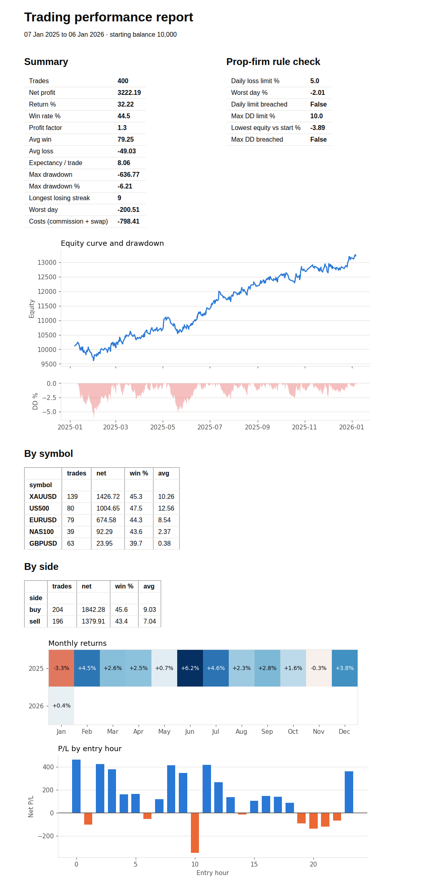

# mt5-trade-journal

**Turn your MetaTrader 5 trade history into a clear performance report in one command.**

Export your history from MT5, run one script, and get a single HTML report with:

- **Summary:** net profit, return, win rate, profit factor, expectancy, average win/loss, longest losing streak, worst day, and how much commission and swap cost you
- **Prop-firm rule check:** would this history have breached a daily loss limit or max drawdown? (limits are configurable)
- **Equity curve with drawdown**
- **Monthly returns heatmap**
- **Breakdown by symbol and by side** (buy vs sell)
- **P/L by entry hour**, to see which sessions make or lose money



*The preview uses randomly generated sample trades, not real trading results.*

## Use it

```bash
pip install -r requirements.txt

# demo with sample trades
python examples/make_report.py

# your own history: MT5 → Toolbox → History → right-click → Positions → Report (save as Excel/CSV)
python examples/make_report.py my_history.xlsx 10000      # file + starting balance
```

The report is written to `report.html`. Open it in any browser, or print it to PDF.

## Built with

Python, pandas, NumPy and matplotlib. Charts are embedded in the HTML, so the report is a single file you can email or share. Tested with `pytest`.

---

Need a custom version (MT4 support, extra stats, a dashboard, or reports for several accounts)? **Sahil T.**, trading software developer (MT4/MT5, MQL5, Python). Contact via Upwork or Fiverr.

**License:** All rights reserved. Published for viewing only; see [LICENSE](LICENSE).
